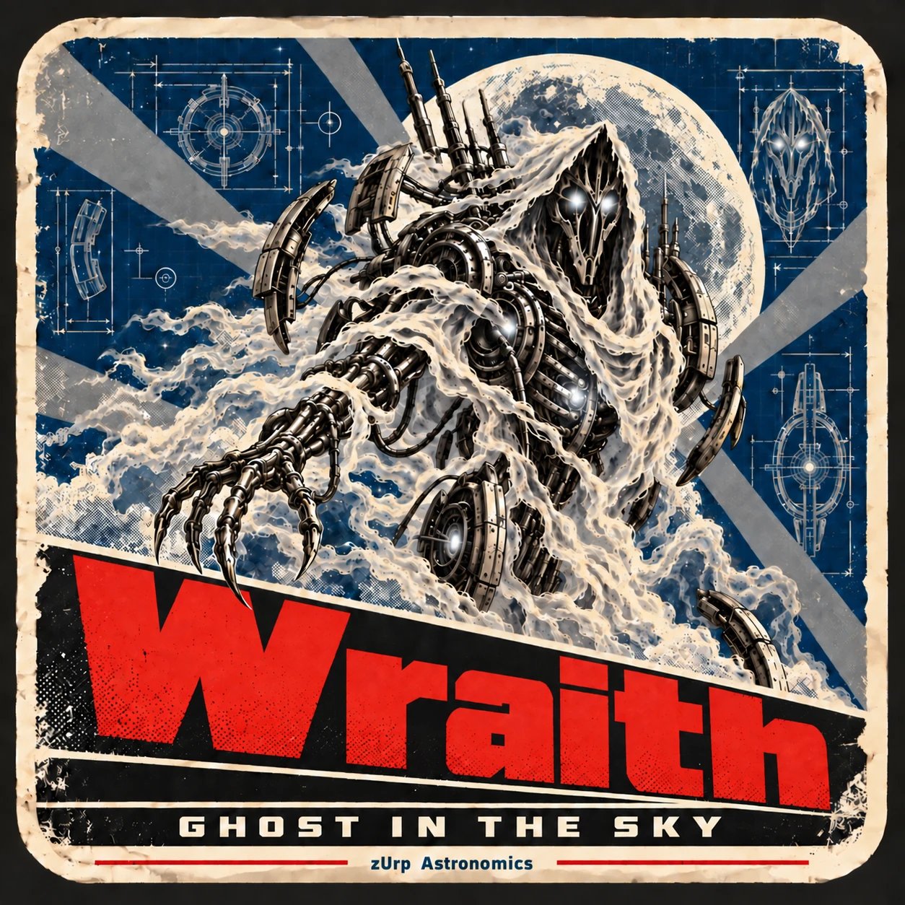

<!-- zurp-readme-header:begin — paste this block once, never again: the poster and the badges update themselves at each build of the site — do not edit it -->

<!-- zurp-readme-header:end -->

<h1 align="center">Wraith</h1>

<strong><em>Ghost in the sky</em></strong>

  <a href="https://zurp-astronomics.github.io/wraith/">Website</a> ·
  <a href="../../releases">Releases</a> ·
  <a href="https://github.com/zUrp-Astronomics">zUrp Astronomics</a>

---

## 🔭 Design phase — nothing to build yet 🔭

**This product is being designed.** No hardware, no firmware, no files to build from yet. 
👀 Watch the repository to follow it from the first sketch.

---

## Why Wraith?

A mount controller here, a mini PC there, and a tangle of cables between them. **Wraith replaces the
whole stack with a single compact unit**: a Raspberry Pi Compute Module 5 running the full mount
control stack, the imaging pipeline, the astrometry solver and a web UI — on one board.

## At a glance

| | |
|---|---|
| Brain | Raspberry Pi Compute Module 5 |
| On board | mount control, imaging pipeline, astrometry solver, web UI |
| Replaces | the usual mount controller + mini PC combo |

## Repository layout

| Folder | Contents |
|---|---|
| [`9_Assets/`](9_Assets/) | the showcase: product sheet, poster and README images |

## License

- **Hardware design** — boards, mechanics and 3D models: [Open Community License v1.1](LICENSE-HARDWARE).
- **Everything else** — firmware, software, documentation and images: [GNU GPL v3.0](LICENSE).

---

<a href="https://zurp-astronomics.github.io/">zUrp Astronomics</a> — a subsidiary of zUrp Industries. Because buying is cheating.

